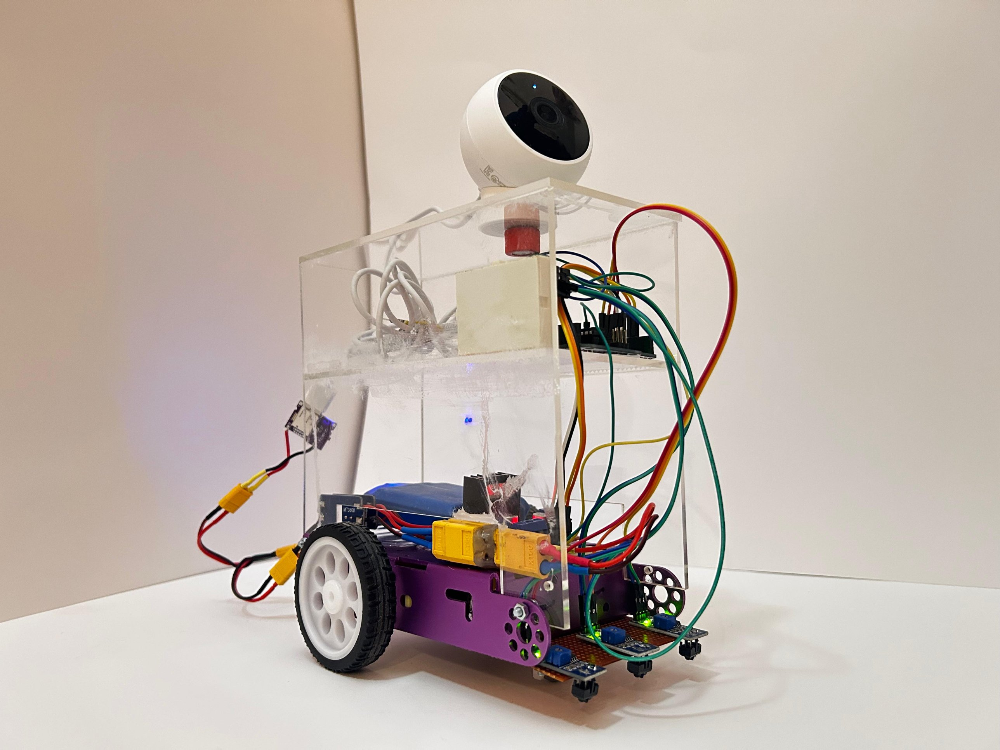
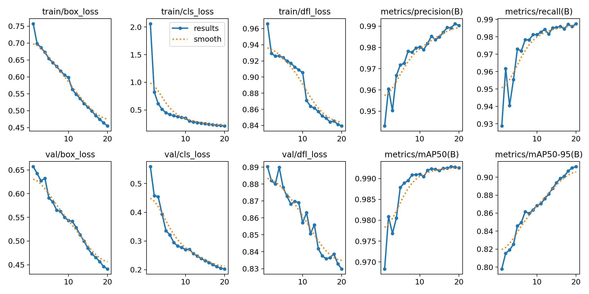
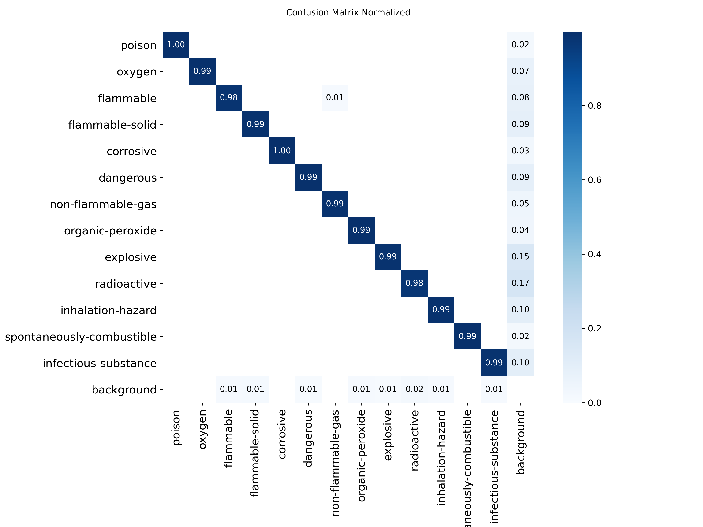

# EmberBot

**A line-following rescue robot that watches for fire and hazardous-materials signs through an onboard camera.**
Built by Team NDA for the World Robot Olympiad (WRO), Senior category, June–July 2025.

**My role:** I designed and built the robot's hardware and wrote all of its code: the Arduino line-following controller, the fire detector, and the hazmat detection model, which I trained myself. My teammates prepared the team's presentation and competition materials.


▶️ [Full 45-second demo video](media/demo.mov)



---

## What it does

EmberBot runs three systems at once:

| System | How it works | Code |
|---|---|---|
| **Line following** | Three IR sensors under the front read black/white; an Arduino Uno steers two motors through an L298 driver to stay on a black line. | [`line_following/`](line_following/) |
| **Fire detection** | The camera feed is screen-captured on a laptop and an OpenCV Haar cascade flags flame-like regions with a red **FIRE DETECTED!** box. | [`vision/fire_detection/`](vision/fire_detection/) |
| **Hazmat sign detection** | A YOLOv8 object detector, trained on the Hazmat13 dataset, finds and labels hazardous-materials placards in the same live feed. | [`vision/hazmat_detection/`](vision/hazmat_detection/) |

### Hardware

- **Body:** metal base with a ball caster at the front, and a clear acrylic casing holding the electronics in two tiers
- **Top tier:** Arduino Uno and a mini breadboard
- **Bottom tier:** L298 motor driver, three IR line sensors, and a custom rechargeable battery feeding two step-up (boost) converters
- **Camera:** Mi Camera 2K, magnet-mounted on top of the casing

### How the camera reaches the AI

The Mi Camera streams to its app on a laptop. Instead of writing a custom video driver, both vision scripts **screen-capture that live feed** with [`mss`](https://github.com/BoboTiG/python-mss) (a 640×600 region of the screen) and run detection on every frame. This kept the robot's own electronics simple: the Arduino only handles driving, and the heavier AI runs on the laptop.

```
 Mi Camera 2K ──Wi-Fi──▶ camera app on laptop ──screen capture (mss)──▶ YOLOv8 hazmat model
                                                                    └─▶ Haar cascade fire model
 IR sensors ──▶ Arduino Uno ──▶ L298 driver ──▶ motors        (line following, independent)
```

---

## Hazmat detection model

A YOLOv8-nano model fine-tuned on Hazmat13 (https://www.kaggle.com/datasets/eliasschramm/hazmat13), a dataset of 13 classes of hazardous-materials signs, originally published by the MRL-AMRL team (https://github.com/mrl-amrl/HAZMAT13).

| Setting | Value |
|---|---|
| Base model | `yolov8n.pt` (pretrained, Ultralytics) |
| Epochs | 20 |
| Image size | 640 |
| Batch size | 150 |

**Results on the validation split after 20 epochs:**

| Precision | Recall | mAP@50 | mAP@50–95 |
|---|---|---|---|
| 0.990 | 0.988 | 0.993 | 0.912 |

These scores come from validation images drawn from the same dataset, so they overstate real-world accuracy. The live tests in the demo (signs far away, close up, and upside down on a can) are the better guide to how it performs on the robot.

<p>
  
  
</p>

All training charts and sample predictions are in [`vision/hazmat_detection/training_results/`](vision/hazmat_detection/training_results/).

### How the training setup evolved

Getting the training to run took several attempts. On 30 June 2025 the first scripts went through **28 training runs** that crashed or stopped early. The fix was to rewrite the pipeline into [`train.py`](vision/hazmat_detection/train.py), which builds clean train/validation folders from the dataset's manifest files and writes its own `data.yaml` before training. The working model was trained on 4 July 2025. The earlier scripts are kept in [`experiments/early_hazmat_training/`](experiments/early_hazmat_training/).

Along the way, [`experiments/traffic_sign_classifier.ipynb`](experiments/traffic_sign_classifier.ipynb) builds a convolutional neural network from scratch in TensorFlow/Keras on the German Traffic Sign Recognition Benchmark (43 classes). It reaches **95.5% accuracy** on the held-out test set.

---

## Testing

- **Line following:** calibrating the IR sensors was harder than expected. Small changes in lighting, surface texture and sensor position caused inconsistent tracking, and it took several rounds of tuning before the robot followed the path reliably.
- **Fire detection:** tested under different light sources. The cascade reliably picks out the brightest light in the room, which also means a bright lamp can be mistaken for fire.
- **Hazmat detection:** tested with different signs, checking the confidence score for each, including at a distance, close up, and upside down.

### Known limitations and what I'd improve

- The fire detector responds to brightness rather than to fire specifically. A small YOLO model trained on flame images, or a check for colour and flicker, would cut false alarms.
- Vision runs on a laptop by screen-capturing the camera app, so the robot isn't self-contained. A next version could run the model on a Raspberry Pi with a directly connected camera.
- The robot advances in short pulses: it moves for 20–30 ms, stops, and re-reads the sensors, which keeps it slow enough to track the line. Proper PWM speed control on the L298 enable pins would give smoother, faster motion.

---

## Repository layout

```
emberbot/
├── line_following/
│   └── line_following.ino         Arduino line-following controller
├── vision/
│   ├── hazmat_detection/
│   │   ├── train.py               prepares the dataset and trains YOLOv8
│   │   ├── test.py                runs the model on a single image
│   │   ├── detect_screen.py       live detection on the camera feed
│   │   ├── convert_voc_to_yolo.py converts VOC .xml labels to YOLO format
│   │   ├── model/best.pt          trained weights (6 MB)
│   │   └── training_results/      loss curves, confusion matrix, sample predictions
│   └── fire_detection/
│       ├── fire_detection.ipynb   live fire detection on the camera feed
│       └── fire_detection_cascade_model.xml
├── experiments/
│   ├── traffic_sign_classifier.ipynb   CNN on German traffic signs (95.5% test accuracy)
│   └── early_hazmat_training/          first versions of the training scripts
├── media/                         photo, demo video and GIF
└── requirements.txt
```

## Running it

```bash
pip install -r requirements.txt

# Live hazmat detection (open the camera app in the top-left of the screen first)
cd vision/hazmat_detection
python detect_screen.py

# Test the model on one image
python test.py path/to/image.jpg

# Live fire detection: open vision/fire_detection/fire_detection.ipynb and run all cells
```

To retrain, download the Hazmat13 dataset from Kaggle (about 8 GB, not included here), extract it as `trained-dataset/` inside `vision/hazmat_detection/`, and run `python train.py`.

Upload `line_following/line_following.ino` to the Arduino Uno with the Arduino IDE.
